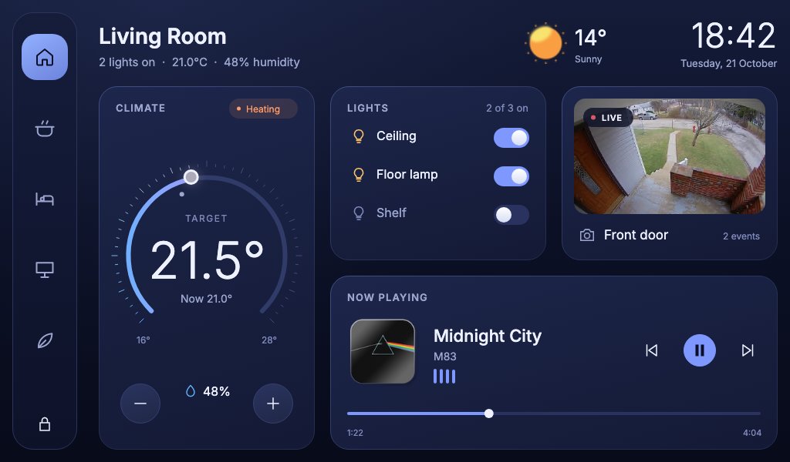

# Home Assistant

A 1024 × 600 home control panel built with Slint paths, SVG icons, gradients, and property animations.
Five rooms share eight cards for climate, lights, energy, media, cameras, scenes, weather, and appliances.

Home Assistant is being developed alongside [Home Automation](../home-automation) as its intended replacement.
This version supports the Rust desktop application, a WebAssembly build, and standalone Slint previews.
It is a simulated UI demo, with no connection to the Home Assistant service or real devices.



## Run

From the repository root:

```sh
cargo run --release --manifest-path demos/Cargo.toml -p home-assistant
```

The demo starts locked and begins an automatic tour after a short delay.
For manual exploration, pass `-- --unlocked --no-tour`.
Use `--room living|kitchen|bedroom|office|garden` to choose the initial room.

The UI also runs without the Rust launcher:

```sh
cargo run --release -p slint-viewer -- demos/home-assistant/ui/app.slint
```

## WebAssembly

Install `wasm-pack` and the `wasm32-unknown-unknown` Rust target, then run:

```sh
cd demos/home-assistant/rust
wasm-pack build --release --target web --no-default-features --features slint/backend-winit,slint/renderer-femtovg
python3 -m http.server
```

Open the local server's `index.html` in a browser.
The demo uses the repository's Slint libraries for both native and WebAssembly builds.

## Controls

- Hold the fingerprint button or Space for 1.2 seconds to unlock.
  Release early or move outside the button to cancel.
- Select a room, swipe across card whitespace, or use Left/Right and the number keys 1–5.
- Drag the thermostat or use its buttons to set a temperature from 16–28°C in half-degree steps.
- Toggle lights, select scenes, and control the simulated music player.
  Each room retains its settings when you navigate away.
- Press `T` to toggle the automatic tour.
  Input pauses the tour for 12 seconds.
- Use the lock button, `L`, or Escape to lock.
- Tap the clock or press `D` for rendering diagnostics.

Camera images, weather, energy, temperatures, time, appliances, music, and talk are simulated.
The demo does not access cameras or microphones, play audio, or control devices.
Particle effects are omitted.

Rendering diagnostics report CPU submission time where the native backend provides rendering callbacks.
These samples do not measure GPU completion or display refresh.
For Skia with OpenGL, run with `--features slint/renderer-skia-opengl` and set `SLINT_BACKEND=winit-skia-opengl`.
WebAssembly and backends without rendering callbacks show that measurements are unavailable.

## Structure

| Path | Purpose |
| --- | --- |
| `ui/app.slint` | Window and keyboard shortcuts |
| `ui/state.slint` | Demo state, actions, and automatic tour |
| `ui/rooms.slint` | Room metadata and card layouts |
| `ui/theme.slint` | Shared colors and animation timing |
| `ui/dashboard.slint` | Persistent card instances and room transitions |
| `ui/lock-screen.slint` | Unlock gesture and sliding panels |
| `ui/components/` | Shared controls and vector drawing |
| `ui/cards/` | Eight independent card components |
| `rust/` | Desktop and WebAssembly entry points |
| `assets/` | Images, fonts, and vector icons |
| `tests/ui_smoke.py` | Native interaction checks |

## Validation

From the repository root:

```sh
cargo test --manifest-path demos/Cargo.toml -p home-assistant
SLINT_EMIT_DEBUG_INFO=1 cargo build --manifest-path demos/Cargo.toml -p home-assistant --features ui-testing
python demos/home-assistant/tests/ui_smoke.py target/debug/home-assistant
SLINT_TEST_FILTER=demos/home-assistant cargo test --manifest-path tests/Cargo.toml -p test-driver-interpreter example_home_assistant
```

The Python check requires [`slint_testing`](https://testing.slint.dev/).
It covers repeated unlocks, cancellation, delayed event processing, room transitions, per-room settings, controls, keyboard navigation, and the automatic tour.
Native captures are written to the ignored `captures/` directory.

## Replacement Plan

Before retiring Home Automation:

- Port and validate the Node and mobile entry points.
- Integrate and qualify ESP-IDF and Zephyr targets, including software-renderer behavior on the supported displays.
- Migrate container defaults, downloadable platform packages, and existing demo URLs.

The current demo and its platform integrations remain available during this work.
No hardware build or device performance is implied by desktop validation.

## Credits

Adapted from the [P4 home automation demo](https://github.com/slint-ui/ux-playground/tree/ddfe88cb3dcbe1e38da907b6f5b30ff82b7a9ef2/p4-home-automation).
Code and icon paths retain the original MIT licensing.
See [asset credits](assets/README.md) for image and font provenance.
