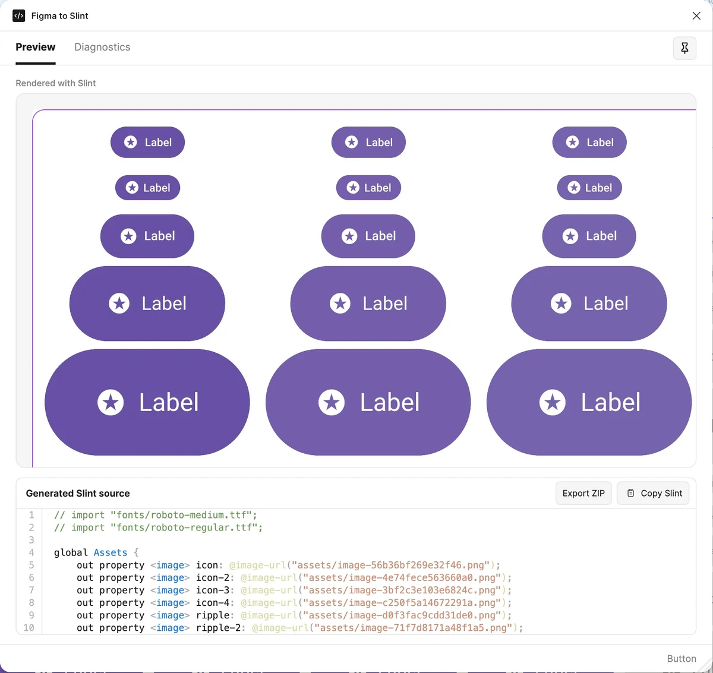
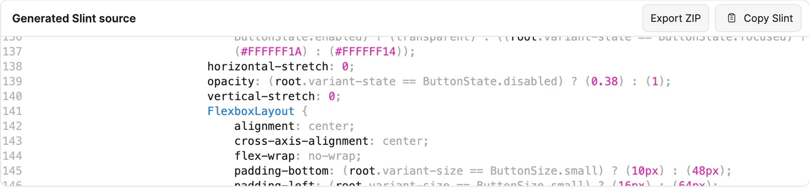

The **Figma to Slint** plugin turns a selected Figma design into Slint source.
Preview the result in Figma, then export a project to continue building your application in Slint.
Conversion and preview run locally without sending your design to an external service.



## Install the Plugin

Open [Figma to Slint in Figma Community](https://www.figma.com/community/plugin/1474418299182276871/figma-to-slint) and run it in a design file.

## Preview a Selection

1. Select a frame, component, instance, or other layer on the Figma canvas.
2. Run **Figma to Slint**.
3. Compare the **Rendered with Slint** preview with your design.
4. Inspect **Generated Slint source** below the preview.

Select another layer to update the preview and source.
Start with a single component or a small frame to review the conversion before exporting a larger screen.

Use the pin button to keep the current preview root while selecting other layers in Figma.
Unpin it to follow the selection again.
Pinning resets when you restart the plugin or switch pages or files.

### Copy the Source

Choose **Copy Slint** to copy the generated source.
Use it to inspect the conversion or bring a small selection into an existing Slint file.



For a complete selection with reusable components and image assets, choose **Export ZIP**.
The project export can differ from the preview source because it includes reusable component definitions and separate asset files.

## Export an Editable Project

Choose **Export ZIP**, then extract the downloaded archive.
Open `main.slint` in the [Slint extension for Visual Studio Code](../vscode/) to preview and edit the result.

The archive contains:

```text
main.slint
assets/
fonts/
    README.txt
README.txt
```

| File or Folder | Purpose |
| --- | --- |
| `main.slint` | Generated UI source, including reusable components for supported Figma components and variants. |
| `assets/` | Images and other exported visual assets referenced by the source. |
| `fonts/README.txt` | Required font families, styles, and instructions for adding font files. |
| `README.txt` | Instructions for opening the project and conversion warnings. |

Keep `assets/` and `fonts/` beside `main.slint` so relative paths resolve.
Add application behavior, callbacks, and data bindings in your Slint project.
Exporting the design doesn't implement your application's logic.

### Keep Design Tokens and Variants

For supported component families, the export generates reusable Slint components with properties for their variants.
Supported variable bindings appear in a generated `DesignTokens` global.
Collections with multiple modes have properties for choosing a mode.
Inspect the generated names in `main.slint` before connecting these properties to your application.
Diagnostics identifies bindings that retain their captured values instead of a shared token reference.

### Match the Fonts

Font files aren't included in the ZIP.
Read `fonts/README.txt`, add the required fonts, and uncomment their import lines at the top of `main.slint`.
Update the import extensions if your fonts use a different file format.

The export runs with fallback fonts before you add them, but text appearance and layout can change.
The Figma preview can use images for text that the plugin's embedded fonts can't render faithfully.
The project export keeps supported text editable, so check it again with the correct fonts.

## Generate Snippets in Dev Mode

Use Figma **Dev Mode** when you need the Slint properties of an individual selected layer.
Choose **Slint** in the code panel's language selector.
The plugin also provides snippets through Figma's VS Code extension.

Dev Mode snippets describe the selected layer only.
Use the plugin's preview and ZIP export to convert its child layers and export a complete UI.
