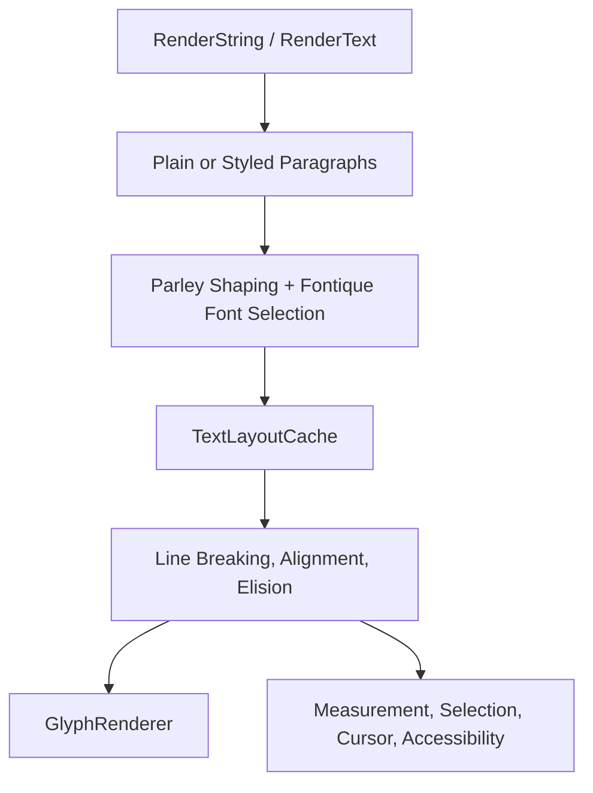

# Text Layout System

> Note for AI coding assistants (agents):
> **When to load this document:** Working on `internal/core/textlayout.rs`,
> `internal/core/textlayout/`, `internal/core/styled_text.rs`,
> text rendering, line breaking, or font handling.
> For general build commands and project structure, see `/AGENTS.md`.

## Overview

Slint shares Parley-based text layout across FemtoVG, Skia, Anyrender, Qt, and the software renderer's vector-font path.
The `shared-parley` feature enables this implementation and is part of `i-slint-core`'s default features.
It handles plain and styled text, font fallback, shaping, line breaking, alignment, elision, selection, and cursor geometry.

The software renderer also uses a separate layout implementation for bitmap fonts, including embedded `no_std` configurations.
With system fonts enabled, `SLINT_SOFTWARE_RENDERER_PARLEY_DISABLED` selects that implementation for vector fonts too.
The switch is read once, when the software renderer first checks whether to use Parley.
See [Legacy Software Text Layout](#legacy-software-text-layout) below.

## Key Files

| File | Purpose |
|------|---------|
| `internal/core/item_rendering.rs` | `RenderString`, `RenderText`, and `TextForWidth` adapters |
| `internal/core/items/text.rs` | Text items, layout constraints, and input editing |
| `internal/core/renderer.rs` | Shared text-query implementations in `RendererSealed` |
| `internal/core/textlayout/sharedparley.rs` | Font context, measurement, drawing, hit-testing, and cursor entry points |
| `internal/core/textlayout/sharedparley/shaping.rs` | Paragraph creation and Parley style/shaping setup |
| `internal/core/textlayout/sharedparley/cache.rs` | Per-item shaping and content-width caches |
| `internal/core/textlayout/sharedparley/layout.rs` | Line breaking, alignment, elision, line limits, and geometry queries |
| `internal/core/textlayout/sharedparley/draw.rs` | `GlyphRenderer`, glyph runs, decorations, and clipping |
| `internal/core/textlayout/sharedparley/selection.rs` | Selection geometry and drawing spans |
| `internal/core/textlayout/sharedparley/accessibility.rs` | AccessKit text runs from the rendered input layout |
| `internal/core/font_collection.rs` | Per-context Fontique collection initialization |
| `internal/core/styled_text.rs` | Public `StyledText` API and FFI |
| `internal/common/styled_text.rs` | Markdown/HTML parsing and styled paragraph data |
| `internal/core/textlayout.rs` | Legacy `TextLayout` and `TextParagraphLayout` |

## Shared Parley Pipeline



### Text and Font Inputs

`RenderString` supplies text, a font request, a line limit, and a line-height factor.
`RenderText` adds drawing properties such as alignment, overflow, brushes, and selection.
Text items implement these traits in `internal/core/items/text.rs`.

Each `SlintContext` owns a shared `FontContext`, which wraps Parley's font context and its Fontique collection.
`FontRequest::query_fontique` resolves font requests.
`FontContext::query_font` memoizes the resolved font and its natural line-height ratio until the next frame.

### Paragraph Shaping

`shape_paragraphs` reads the item's shaping inputs through `shaping_builder` and calls `create_text_paragraphs`.
Plain text is split at newline boundaries; styled text already carries paragraphs and formatting spans.
The builder applies font families, size, weight, italic style, letter spacing, line height, and wrap policy.
Styled spans add properties such as emphasis, code formatting, link styling, and color.

Parley produces a `parley::Layout<Brush>` for each paragraph.
Slint's `TextParagraph` retains the source byte range, links, and decoration ranges alongside it.
The legacy `ShapeBuffer` and `TextShaper` types aren't part of this path.

### Line Breaking and Placement

`layout` in `sharedparley/layout.rs` applies the available width to the shaped paragraphs.
It calls Parley's line-breaking and alignment APIs, then computes paragraph positions, line limits, and elision.

| Input | Behavior |
|-------|----------|
| `TextWrap::NoWrap` | Disables soft wrapping; explicit paragraph breaks remain |
| `TextWrap::WordWrap` | Wraps at word boundaries, with an anywhere fallback for overlong words |
| `TextWrap::CharWrap` | Uses Parley's break-all policy |
| `max-lines` | Limits visible lines across paragraphs |
| `TextOverflow::Clip` | Clips drawing to the item's bounds |
| `TextOverflow::Elide` | Adds an ellipsis when text is truncated |
| Horizontal/vertical alignment | Positions lines and the paragraph block within the available size |

Layout uses physical pixels internally.
Entry points convert logical sizes and positions with the window's scale factor.

The line-height factor scales the requested font's natural line-height ratio.
The builder passes this to Parley as a font-size-relative line height, so styled font sizes scale with it.
Fallback fonts don't independently enlarge the requested line box.
Glyph bounds can still affect measured height when line spacing is compressed.

### Drawing and Geometry Queries

Renderers implement `sharedparley::GlyphRenderer` to draw positioned glyph runs, brushes, and decoration rectangles.
`draw_text` and `draw_text_input` use this interface for text, selection backgrounds, and the input cursor.

With `shared-parley` enabled, `RendererSealed` provides default implementations for measurement, font metrics, hit-testing, and cursor rectangles.
Renderers expose their cache through `text_layout_cache()`.
The software renderer overrides these methods to choose between Parley and its bitmap-font layout.

Input hit-testing and cursor rectangles use Parley's cursor APIs, including affinity at soft line breaks.
The entry points translate between the input's visual text and its actual byte offsets, including password and preedit text.
`with_text_input_layout` lends the rendered layout to accessibility code when the renderer reports a Parley layout.
The `accessibility-text` feature enables AccessKit text runs based on that geometry.

### Cache and Property Dependencies

`TextLayoutCache` stores shaped paragraphs per `ItemRc`.
Property tracking invalidates entries when shaping inputs change.
The wrap mode and line-height factor distinguish compatible entries; a scale-factor change invalidates the cache.
Width is applied after shaping, so resizing can reuse shaped paragraphs.

The cache also retains line breaking for matching width, alignment, line limit, and overflow inputs.
Height and vertical alignment are applied per call.
Intrinsic content widths have a separate cache because measuring the longest word needs different overflow-wrapping behavior.

`with_text_layout` checks paragraphs out of the cache, lays them out, runs a callback, and restores them.
The font-context borrow ends before the callback, allowing glyph drawing to access fonts.
The cache stays borrowed during the callback: don't read properties or re-enter text layout there.

Width-only measurement uses `TextForWidth`, whose line-height factor is `None`.
This avoids evaluating a line-height binding that can depend on the width being measured.
Preserve that distinction when changing measurement or cache dependencies.

## Font Collection Initialization

Each `SlintContext` owns its Fontique collection.
When Slint creates the backend itself, `font_collection::prefetch()` starts system font discovery on a worker thread,
and a `SlintContext` created on that thread while the returned guard lives takes the result.
Dropping the guard discards the result if no context used it.
Otherwise, a context discovers system fonts synchronously.
Before a thread has a context, applications can supply a collection with `slint::fontique_012::set_shared_collection()`.
`prefetch()` then doesn't start, and the next context on that thread takes the collection as is,
without the fonts from `SLINT_DEFAULT_FONT` and `SLINT_FONT_PATH`.
It still registers embedded fonts.
See `internal/core/font_collection.rs`.

Configure Fontconfig before Slint creates the backend.

## Styled Text

`Style`, `FormattedSpan`, and `StyledTextParagraph` live in `internal/common/styled_text.rs` and are available without parsing support.
A paragraph contains text, styles applied to byte ranges, and link destinations.
`internal/core/styled_text.rs` provides the public `StyledText` API and FFI.

`StyledText::from_plain_text()` creates a paragraph without parsing.
`StyledText::from_markdown()` parses formatting and reports failures as `StyledTextFromMarkdownError`.
The parser supports emphasis, strong text, strikethrough, inline code, links, lists, and line breaks.
It also supports HTML underline and span colors.

The common crate's `markdown` feature enables Markdown/HTML parsing; `i-slint-core/std` enables that feature.
In the Parley path, `sharedparley/shaping.rs` maps spans to Parley styles, and `draw.rs` renders decorations and selections.

## Legacy Software Text Layout

This implementation remains active for software bitmap fonts and for vector fonts when Parley is explicitly disabled.
It works with the font abstractions in `internal/renderers/software/fonts/`.
It doesn't use Parley's shaping cache or line layout.

```text
ShapeBoundaries
    → TextShaper / ShapeBuffer
    → GlyphClusterIterator
    → TextFragmentIterator
    → TextLineBreaker
    → TextParagraphLayout::layout_lines()
```

| File | Purpose |
|------|---------|
| `internal/core/textlayout/shaping.rs` | `TextShaper`, `FontMetrics`, `Glyph`, `ShapeBuffer`, and script boundaries |
| `internal/core/textlayout/glyphclusters.rs` | Groups shaped glyphs by source cluster |
| `internal/core/textlayout/fragments.rs` | Groups clusters between line-break opportunities |
| `internal/core/textlayout/linebreaker.rs` | Fits fragments to lines and tracks trailing whitespace |
| `internal/core/textlayout/linebreak_unicode.rs` | Unicode line-break opportunities |
| `internal/core/textlayout/linebreak_simple.rs` | Simple fallback without `unicode-linebreak` |
| `internal/core/textlayout.rs` | Measurement, paragraph placement, elision, and cursor queries |

### Fonts and Shaping

`AbstractFont` combines `TextShaper` and `FontMetrics` over the same length type.
`TextShaper::shape_text` produces glyph advances, offsets, font-specific IDs, and source byte offsets.
`ShapeBuffer` retains those glyphs and their source runs.
`ShapeBoundaries` splits text by script when `unicode-script` is enabled.
Letter spacing is added to the last glyph's advance in each grapheme cluster.

### Lines and Paragraphs

`TextLayout` combines a font with optional letter spacing and an absolute line height.
A missing line height uses `FontMetrics::height()`.
The software renderer converts `line-height-factor` to an absolute height before this stage.
`half_leading()` centers glyphs within the line box, while `cursor_band()` keeps cursor and selection rectangles at least as tall as the glyph box.

`TextLineBreaker` fits fragments to the available width using the wrap mode and line limit.
It tracks trailing whitespace separately so alignment can exclude it.

`TextParagraphLayout` adds the string, bounds, alignment, wrapping, overflow, and line limits.
Its `layout_lines()` callback receives positioned glyphs and selection ranges for each line.
`cursor_pos_for_byte_offset()` and `byte_offset_for_position()` provide cursor geometry for this path.

## Feature Flags

| Feature | Effect |
|---------|--------|
| `i-slint-core/shared-parley` | Shared Parley layout and default renderer text queries |
| `i-slint-core/shared-fontique` | Shared font collection and font matching |
| `i-slint-core/accessibility-text` | AccessKit text runs from Parley input layout |
| `i-slint-core/unicode-linebreak` | Unicode line-break opportunities in the legacy pipeline |
| `i-slint-core/unicode-script` | Script boundaries in the legacy shaping pipeline |
| `i-slint-common/markdown` | Markdown/HTML parsing, also enabled by `i-slint-core/std` |
| `i-slint-renderer-software/systemfonts` | Software vector fonts and Parley integration, also enabled by its `std` feature |

## Debugging and Testing

First identify the renderer, font type, and active layout path.
For software rendering, `uses_parley` in `internal/renderers/software/lib.rs` controls the choice.
Check measurement, drawing, cursor geometry, and accessibility together when changing layout behavior.

For Parley issues, inspect `shape_paragraphs`, `LayoutOptions`, the retained line-breaking inputs, and the resulting paragraph layouts.
For legacy issues, inspect `ShapeBuffer`, `TextFragmentIterator`, and `TextLineBreaker`.

```sh
# Shared Parley layout tests
cargo test -p i-slint-core textlayout::sharedparley

# Both Parley and legacy text layout tests
cargo test -p i-slint-core textlayout

# Cache invalidation and reuse through the software renderer
cargo test -p slint --test text_layout_cache

# Markdown and styled paragraph parsing
cargo test -p i-slint-common --features markdown styled_text
```

Parley unit tests live in `internal/core/textlayout/sharedparley/tests.rs`.
Cache integration tests live in `api/rs/slint/tests/text_layout_cache.rs`.
For behavior shared by generated code and the interpreter, extend the relevant cases under `tests/cases/elements/`.
