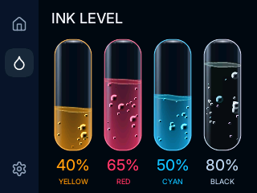

# BOX-3 Printer Kiosk and Tilt Qualification

Measured on October 19, 2026, at native 320×240, CPU 240 MHz, and panel SPI 40 MHz.
The observed panel cadence is approximately 59.94 Hz.
The port retains immutable DMA packets, scanline gating, DMA polling backoff, pixel-snapped lists, PIE fills, and the timestamped touch worker.

## Port Steps

| Step | Workload | Changing FPS | Mean Draw | Repeated Frames | Late Packets |
| --- | --- | ---: | ---: | ---: | ---: |
| Native Slint controls | Queue | 60.007 | 12.61 ms | 0 | 0 |
| Native Slint controls | Settings | 60.011 | 13.11 ms | 0 | 0 |
| Native Slint controls | Ink | 60.023 | 10.02 ms | 0 | 0 |
| Panel-driven Kiosk | Queue | 59.996 | 13.44 ms | 0 | 0 |
| Panel-driven Kiosk | Settings | 59.975 | 13.63 ms | 0 | 0 |
| Panel-driven Kiosk | Ink | 59.962 | 10.01 ms | 0 | 0 |
| Live tilt with native texture copies | Ink | 59.953 | 8.22 ms | 0 | 0 |
| Two-core tilt with all-vial pulses | Ink | 59.984 | 8.05 ms | 0 | 0 |

Each row measures one ten-second animated window after warmup.
The native-control tests use injected list gestures.
Kiosk scrolls one pixel per acquired panel tick, so their draw times are different workloads.
Draw includes Slint rasterization and packet publication; it excludes particle preparation and input dispatch.

## Final Repeated Qualification

| Workload | Windows | Frames | Changing FPS | Mean Producer | Minimum Ready Margin | Repeated Frames | Late Packets |
| --- | ---: | ---: | ---: | ---: | ---: | ---: | ---: |
| Changing tilt, all vials pulsed | 3 × 10 s | 1,798 | 59.950 | 13.42 ms | 1.962 ms | 0 | 0 |
| Changing tilt, all vials held | 3 × 10 s | 1,798 | 59.933 | 13.43 ms | 2.044 ms | 0 | 0 |
| Changing tilt, Black touch pulses | 3 × 10 s | 1,799 | 59.941 | 13.24 ms | 0.938 ms | 0 | 0 |
| Final Kiosk Queue | 10 s | 599 | 59.956 | 13.99 ms | 1.913 ms | 0 | 0 |
| Final Kiosk Settings | 10 s | 599 | 59.930 | 14.17 ms | 1.579 ms | 0 | 0 |
| Final Kiosk live Ink | 10 s | 599 | 59.914 | 13.15 ms | 3.265 ms | 0 | 0 |

All 7,192 final measured frames had zero repeated frames, skipped panel cycles, timeouts, late packets, late cycles, and truncated traces.
Every presented packet reached its requested panel tick.
The producer spans frame acquisition through packet readiness, including particle work, input, Slint rendering, and packing.
The ready margin measures packet readiness before the destination panel blank.
Display transfers overlap production on the other core.
The stress-test wire time averages approximately 12.6 ms per frame.

The simultaneous hold cases set all four hold flags directly; they exercise rendering rather than four physical fingers.
The Black pulse fixture dispatches real Slint touch events at the vial hit area.
Its smallest ready margin is narrower than the sustained-rendering margin.
These finite runs qualify these workloads, rather than every future gesture or hardware fault.

## Sensor and Rendering Integration

The physical ICM-42607-P responds at `0x68` with device ID `0x60`.
Both accelerometer and gyroscope run at 100 Hz, with ±4 g and ±500 degrees per second ranges.
The display worker polls once per panel cycle while Ink is active, after servicing touch.
It publishes fused gravity through one atomic word.
The UI thread performs no I²C transactions.
All final windows record zero IMU and touch-worker read errors.
Replay runs still read the real sensor, then feed repeatable acceleration and angular velocity through the production fusion filter.
The final Kiosk run uses live sensor samples.
The framebuffer orientation maps sensor X/Y through the display's 180-degree landscape rotation.
Physical hand-tilt direction and optical tear freedom were not observed during this unattended qualification.

The BOX density remains 32 bubbles at full capacity, scaled by fill level, with a 30 percent hold boost.
The four current levels draw 76 normal bubbles and up to 100 held bubbles.
Bubble size, reflective shading, fractional motion, curved surfaces, and damped sloshing remain enabled.
Extra bubbles retire at the surface after release.

Native 48×140 glass and liquid artwork resides in flash, retaining exact procedural pixels.
The texture hook copies opaque, unscaled RGB565 images through Slint's dirty-region clip.
Other texture operations use the default renderer.
Two vials prepare and paint on the display core during DMA waits; two compose on the UI core.
The worker receives only borrowed plain state and pixel slices.
It finishes before Slint images are published, and published DMA packets remain immutable.

## Validation and Limits

All seven final 76,800-pixel captures match a canonical full redraw with zero differences.
The final Kiosk fixture verifies touch-to-exit.
The host suite passes 36 tests, including 900 serial-versus-parallel animation steps across all four vials.
A separate renderer fixture compares 720 retained frames with canonical rendering, including negative positions, clipping, alpha, and scaled fallback.
The default non-BOX configuration also passes all 36 host tests.
Five animation-clock tests, four touch polling-policy tests, and the Kiosk motion test pass.

Kiosk measurements use twelve-second diagnostic scenes, with a one-second settling interval before each ten-second measured window.
Normal Kiosk scenes remain ten seconds.
Page transitions and capture/log output are outside those animated windows.
A full 320×240 RGB565 transfer requires at least 30.72 ms at 40 MHz SPI.
These results therefore do not claim a full-screen page replacement fits into one panel refresh.
Software captures and scan deadlines do not establish physical panel quality or optical tear freedom.

## Optimization Findings

A first serial tilt implementation achieved approximately 45 FPS.
After native texture copying, live Ink matched the panel, but changing tilt and all-vial pulses still averaged 50.466 FPS.
That serial stress window repeated 95 frames and recorded 171 late packets.
Surface preparation, restoration, and particle shading were the dominant added work.
Overlapping bounded composition with DMA waits raises that workload to the panel cadence without reducing particle counts or effects.

A broad instruction-RAM trial was rejected after startup failure.
It reduced the available main stack from 19,944 to 9,512 bytes.
Those code-placement changes were removed and are absent from the final firmware.
The final two-core build retains 19,944 bytes of main stack.
The BOX branch does not contain the Pico prepared-text cache, so the Pico cache-lifetime fix was not applicable.

## Reproduction and Artifacts

Use the [BOX build and profile instructions](../../../../../demos/printerdemo_mcu/README.md).
For each stress case, build with `box-bench`, `BOX_BENCH_SCENE=ink`, `BOX_BENCH_WINDOWS=3`, and `BOX_BENCH_TILT=replay`.
Use `BOX_BENCH_INK_HOLD=all` with workloads `pulse` and `held`.
Use `BOX_BENCH_INK_HOLD=black` and workload `pulse` for Slint touch transitions.
Set `BOX_BENCH_SCENE=kiosk` without replay or hold overrides for the actual Kiosk controller and live IMU.
The collector checks deadline counters, trace targets, sensor errors, and capture parity.

The JSON files retain per-window measurements and firmware hashes.
The release manifest records the pre-audit source commit `4d8a4d8494`, compiler flags, and interactive image with benchmark injection disabled.
Its hashes identify that historical artifact, rather than the rewritten branch tip.
The interactive release starts Kiosk on boot; touch exits to normal operation.

The interactive release passed flash verification and 55 seconds of boot observation without a panic.
The GT911 initialized at its backup address, and the live IMU produced samples when Kiosk entered Ink.

## Deletion Audit and History Cleanup

The audit covers the thirteen commits after `b541c3629e`.
Their changes form five commits: held bubbles, native controls, kiosk, tilt rendering, and parallel composition.
Profiling and qualification accompany the feature they verify.

The cleanup removes three identical 6,720-byte mask files and shares the remaining mask across all four vials.
It removes unused sensor-flip methods, a replaced animation setter, unused paint introspection, and no-op worker wake callbacks.
IMU timing instrumentation compiles only into profiling builds.
The shared renderer retains the requested 30 percent hold boost on every target.
The BOX population and rendering formulas remain unchanged.

Both BOX and default host configurations pass 35 physics, sensor, cache, and worker tests.
The renderer fixture passes 720 retained-versus-canonical frames.
The kiosk motion test passes, and Rust formatting and Python syntax checks pass.

The cleaned firmware repeats each workload for ten measured seconds:

| Workload | Frames | Changing FPS | Mean Producer | Minimum Ready Margin | Repeated Frames | Late Packets |
| --- | ---: | ---: | ---: | ---: | ---: | ---: |
| Replay tilt, all vials pulsed | 600 | 59.930 | 13.38 ms | 2.381 ms | 0 | 0 |
| Kiosk Queue | 599 | 59.943 | 13.89 ms | 1.943 ms | 0 | 0 |
| Kiosk Settings | 599 | 59.916 | 14.17 ms | 1.166 ms | 0 | 0 |
| Kiosk live Ink | 599 | 59.909 | 13.11 ms | 3.314 ms | 0 | 0 |

All 2,397 measured frames record zero repeated frames, skipped cycles, timeouts, late packets, and late cycles.
All three captures match a canonical redraw across 76,800 pixels.
The kiosk fixture also verifies touch-to-exit.
The [pulse](audit-pulse.json) and [kiosk](audit-kiosk.json) summaries retain measurements and firmware hashes.
The same finite-run and physical-observation limits above apply.
