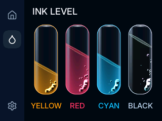

# Final Printer Qualification

The firmware uses 150 MHz CPU, 75 MHz flash and 60 MHz PIO display output.
The native 320-by-240 UI, artwork, particle counts, bubble sizes, sensor fusion, slosh and ripple formulas are unchanged.
Slint still renders the UI; the existing native Ink compositor is unchanged.

Each timing run has a two-second warmup followed by a ten-second measurement window.
Six runs use automatic orientation, followed by two flipped-orientation Ink runs.

| Workload | Raster | Changing FPS | Missed Phases | Late Strips | Scan Errors |
| --- | ---: | ---: | ---: | ---: | ---: |
| Queue auto-scroll | 10.637 ms | 58.59 | 0 | 0 | 0 |
| Settings auto-scroll | 10.652 ms | 58.62 | 0 | 0 | 0 |
| Boosted tilted Ink | 5.986 ms | 58.69 | 0 | 0 | 0 |
| Boosted tilted Ink repeat | 5.992 ms | 58.71 | 0 | 0 | 0 |
| Queue through touch-poll dispatch | 11.420 ms | 58.59 | 0 | 0 | 0 |
| Settings through touch-poll dispatch | 11.056 ms | 58.58 | 0 | 0 | 0 |
| Flipped boosted tilted Ink | 5.953 ms | 58.58 | 0 | 0 | 0 |
| Flipped Ink repeat | 5.951 ms | 58.66 | 0 | 0 | 0 |

Every run matches the measured panel tick count within one boundary frame.
All four boosted Ink runs hold all vials and report unchanged populations of 26, 42, 32 and 52 particles.

## Frame Budget

Subtract average render/publish time and animation time from the measured panel interval.
The result includes unmeasured input and event-loop work, so it is an approximate remaining budget rather than guaranteed spare CPU time.
Display transfer overlaps these stages and must not be added to them.

| Workload | Original Remaining Budget | Final Remaining Budget |
| --- | ---: | ---: |
| Queue | 2.67 ms | 5.20 ms |
| Settings | 0.81 ms | 1.11 ms |
| Boosted tilted Ink | 3.02 ms | 2.32–2.39 ms |

Ink trades average composition time for lower worst-case display interference.
The isolated priority trial reduces maximum observed transfer overhead from 1.583 ms to 0.059 ms, while adding approximately 1.1 ms to composition.
Subsequent scan and packing changes recover part of that cost.
This work does not establish a net increase in Ink's average CPU headroom.

## Pixels, Input and Recovery

Four Queue/Settings framebuffer captures match the original baseline byte for byte.
Controller-memory comparisons match all 76,800 pixels on Queue, Settings and Ink in both orientations.
All 24 checked artwork symbols retain their bytes.
Three complete uncached flash passes match 1,639,672 bytes at the live 75 MHz flash setting.
The updater rejects a mismatched preceding ELF before any device write.

After the final timing and capture sequence, two complete kiosk cycles present another 3,658 frames with zero late strips.
Touch exits kiosk mode and does not activate an underlying control in the host integration check.
The 42 host tests, three wire-format tests, three packet-slot tests, four scan-budget tests and three UF2 tests pass.
The standalone host UI check covers the longer Settings list, kiosk checkbox, sequence, exit and stopped timers.

The capture protocol now waits for the UI core to acknowledge snapshot release before processing subsequent commands.
Earlier diagnostic sequences triggered watchdog recovery, while isolated reads and some repeated old-image sequences passed.
The acknowledgment gap is established in source, but it is not proven to be the sole cause of those earlier recoveries.
The complete final sequence, subsequent Ink readbacks and post-capture health checks complete without recovery.
These are bounded tests, not a guarantee against every future reset.

The final image has 30,524 bytes of static main-stack reservation and passes the unchanged 24 KiB guard.
Measured main-stack headroom remains at least 14,476 bytes across the qualification windows.
The device is left on normal Ink with live tilt and automatic orientation.

