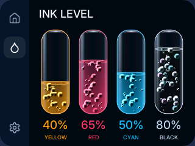

# Qualify Boosted Ink at Stock Speed

The stock 150 MHz firmware now enables the same held-vial boost as the optional 240 MHz build.
Normal counts remain 16/26/20/32; all-four-vial boost holds 26/42/32/52 particles.
Every extra bubble retains radius five, fractional motion, shading, and natural retirement at the liquid surface.
Native 320 × 240 geometry and the surrounding Slint UI are unchanged.
Slint still owns layout, text, controls, input dispatch, and software rasterization.
Custom Rust composes the complete vial images as before.



## Retained Optimizations

| Revision | All-Vial Boost FPS | Particle Stamp | Missed Phases in Ten Seconds |
| --- | ---: | ---: | ---: |
| Fresh baseline | 53.81 | 6.748 ms | 51 |
| Exact opaque-mask arithmetic | 54.93 | 6.384 ms | 39 |
| Cached opaque glass rows | 56.83 | 5.857 ms | 20 |
| Incremental coverage | 58.75 | 5.129 ms | 0 |

Cancel common mask factors for fully covered glass and cache each row's opaque span.
Generate exact coverage through squared-distance differences instead of a 52,224-byte flash atlas.
The hot stamp remains in SRAM; disassembly contains hardware integer division and the incremental arithmetic.
An early highlight-clamping trial did not improve throughput and was removed before committing.

## Final Input Qualification

Every workload settles for two active seconds and retains ten seconds of measurements.
All nine windows meet panel cadence with zero missed phases, late strips, and scan-read errors.
The three additional [all-vial boost windows](repeat-boost.json) also pass at 58.56–58.66 FPS.

| Workload | Changing FPS | Raster | Vial Animation | Missed Phases | Late Strips | Scan Errors |
| --- | ---: | ---: | ---: | ---: | ---: | ---: |
| auto | 58.63 | 12.211 ms | 0.000 ms | 0 | 0 | 0 |
| pan-fast | 58.61 | 12.021 ms | 0.000 ms | 0 | 0 | 0 |
| poll-pan | 58.62 | 12.120 ms | 0.000 ms | 0 | 0 | 0 |
| settings-auto | 58.60 | 12.265 ms | 0.000 ms | 0 | 0 | 0 |
| settings-pan | 58.60 | 12.854 ms | 0.000 ms | 0 | 0 | 0 |
| settings-poll-pan | 58.60 | 12.781 ms | 0.000 ms | 0 | 0 | 0 |
| ink | 58.59 | 8.204 ms | 3.229 ms | 0 | 0 | 0 |
| ink-boost | 58.69 | 8.086 ms | 6.843 ms | 0 | 0 | 0 |
| ink-touch | 58.60 | 8.146 ms | 4.478 ms | 0 | 0 | 0 |

[Input measurements](inputs.json) retain completed presentations, panel ticks, particle counts, heap, stack, and timing stages.
Raster timing excludes vial animation, input, packet preparation, CRC work, and waits.
The final all-vial window averages 16.242 ms across animation and the measured render/publish path.
These stages do not include all event-loop overhead.
Core-1 transport overlaps core-0 work and must not be added as another sequential CPU stage.

## Transitions and Pixels

Two complete Kiosk cycles retain seven-second windows inside each real ten-second view.
All six windows pass the same cadence, phase, late-strip, and scan-error guard.
Ink resources are released before constructing the next page.

| Kiosk View | Changing FPS | Missed Phases | Late Strips | Scan Errors |
| --- | ---: | ---: | ---: | ---: |
| kiosk-queue | 58.63 | 0 | 0 | 0 |
| kiosk-settings | 58.60 | 0 | 0 | 0 |
| kiosk-ink | 58.57 | 0 | 0 | 0 |
| kiosk-queue | 58.63 | 0 | 0 | 0 |
| kiosk-settings | 58.59 | 0 | 0 | 0 |
| kiosk-ink | 58.54 | 0 | 0 | 0 |

[Kiosk measurements](kiosk.json) retain the complete counters.
The lowest observed unused main stack is 7,720 bytes.
The minimum reported free heap is 11,488 bytes.
The link-time main-stack reserve remains 22,864 bytes, above the required 20,480 bytes.
Opaque row storage adds 2,240 heap bytes across the four native vials.

- [Independent native-asset comparison](pixel-parity.json): 19,200 frames and 106,406,400 pixels match the pre-optimization renderer exactly.
- Host tests: all 15 native-asset, arithmetic, direct-reference shading, clipping, resource, and lifetime tests pass.
- Host Kiosk assertions: checkbox, ten-second sequencing, immediate exit, no click-through, and stopped timers pass.
- [Panel comparisons](panel.json): twelve full-GRAM checks each compare 76,800 pixels with zero mismatches.
- [Hold and release checks](release.json): all four vial callbacks register; extra bubbles remain after release and drain to normal counts.
- Release builds: stock normal, stock profiling, and optional 240 MHz normal builds succeed.

These checks establish generated pixels, software cadence, panel-memory delivery, and replayed input behavior.
They do not measure physical finger latency or capture optical scan artifacts.
The device remains on Ink in manual mode at 150 MHz.
[Firmware metadata](firmware.json) identifies the qualified image and memory layout.

## Reproduce

```sh
PICO_PROFILE=1 PICO_SERIAL=BFC13272EF67B96D examples/mcu-board-support/pico2_touch_lcd_2_8/flash-printer.sh
python3 examples/mcu-board-support/pico2_touch_lcd_2_8/profile-printer.py --serial BFC13272EF67B96D --all --require-panel-rate --output /tmp/pico-boost-input
python3 examples/mcu-board-support/pico2_touch_lcd_2_8/profile-kiosk.py --serial BFC13272EF67B96D --cycles 2 --require-panel-rate --output /tmp/pico-boost-kiosk
```
