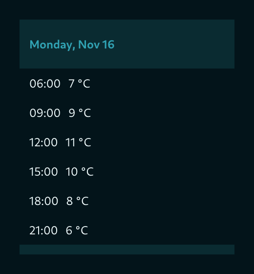

# Sticky List

A list with section headers that stick to the top while their rows scroll by.
The next section's header pushes the current one out.



The overlay header follows the `ListView`'s `current-row` and `item-offset` properties:
`current-row` tells which section is at the top,
and `item-offset` tells how far the next header is from the top edge.

Run it:

```sh
cargo run -p slint-viewer -- examples/sticky-list/slint-project.json
```

[Online code editor](https://slint.dev/snapshots/master/editor/index.html?load_url=https://raw.githubusercontent.com/slint-ui/slint/master/examples/sticky-list/sticky-list.slint)
