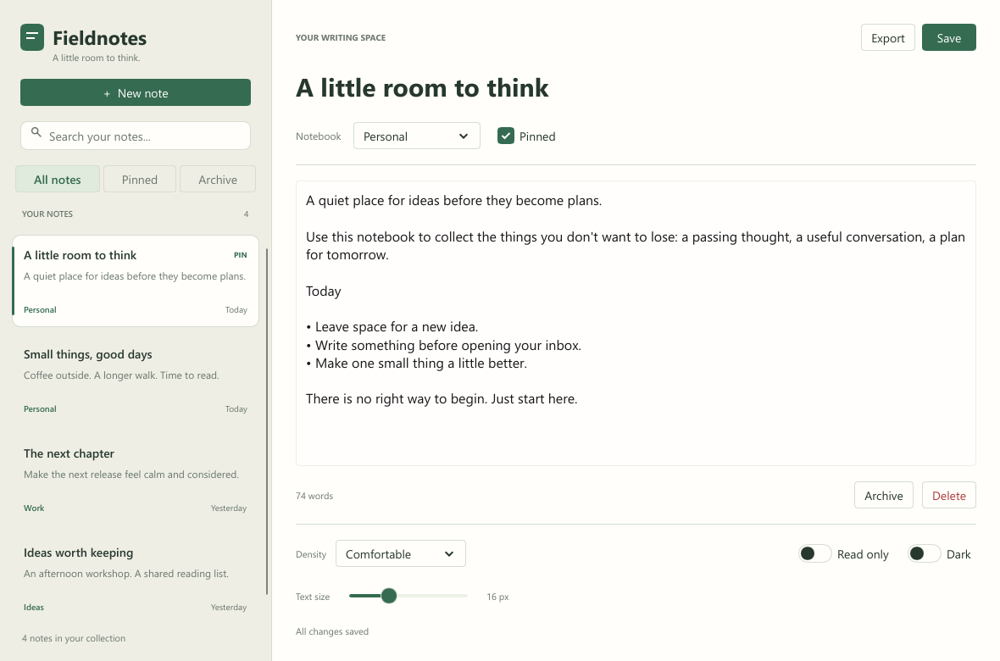
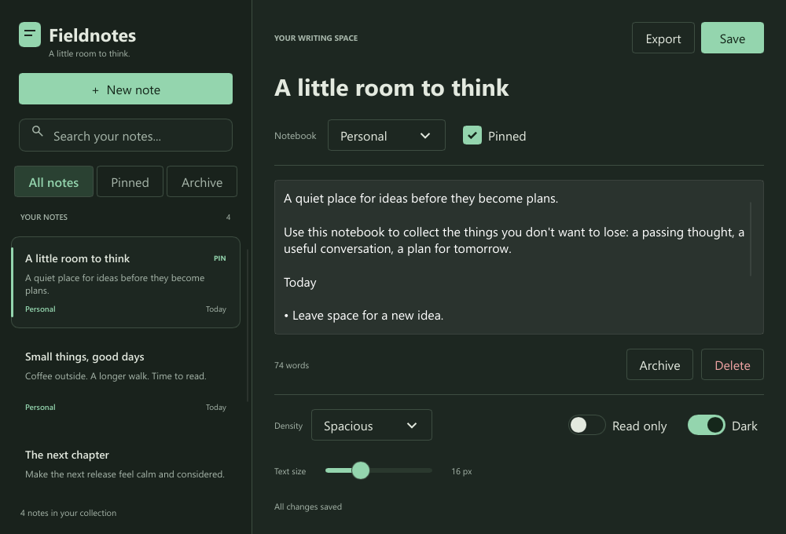

<!-- cspell:words Fieldnotes -->

# Fieldnotes Control Experiment

Built on `ionuc/notes-controls-experiment`, starting from `ionuc/control-styling` at `bff2f23996`.
The branch now includes `b564e5f602`, which adds LineEdit styles, metrics, and optional slot forwarding.
Three subagents implemented the shell, editor, and Rust host.
The main agent integrated the theme, reviewed the app, and verified rendered layouts.
The experiment adds an isolated example; it doesn't change the controls library.

## Result

The existing controls were sufficient for a desktop note app with a custom appearance.
Style and metrics structs worked well for shared defaults and runtime density changes.
The initial text-field consistency and slot forwarding gaps are resolved by the new LineEdit API.
The remaining main gap is a multiline editor that uses the same styling system.

The app supports creating and editing notes, notebook selection, search, pinning, archiving, confirmed deletion, and plain text export.
Edits save locally after a short pause.
Density, text size, dark mode, and read-only settings change at runtime.
See [the README](README.md) for launch commands and data locations.

## How We Used the Controls

| Control | App Usage | Experience |
| --- | --- | --- |
| Basic Button | New, Save, Export, Archive, Delete, and navigation | Presets and a small shared wrapper covered ordinary actions. |
| Basic CheckBox | Pin the selected note | Two-way `checked` binding and `toggled` integrated directly with the host. |
| Basic ComboBox | Notebook and density selection | Existing selection callbacks and metrics worked without custom popup code. |
| Basic Switch | Read-only and dark mode | Bound directly to app settings; disabled the read-only switch when storage prevented edits. |
| Basic Slider | Editor text size | Range, step, value binding, and size presets needed no custom behavior. |
| Basic LineEdit | Note title and search | Search uses size presets and optional slots; the title supplies reusable style and metrics structs. |
| Headless ButtonBase | Note cards and search clear action | Slots supplied custom visuals while the base retained activation, focus, and accessibility. |
| Standard TextEdit | Multiline note body | Supplied selection, undo, scrolling, and editing behavior missing from this basic control set. |

[theme.slint](theme.slint) owns app colors and selects the six control families' existing size presets.
`AppButton` shares those defaults without repeating a style on every instance.
`AppLineEdit` shares the field size presets and forwards both optional slots.
Changing `BasicTheme` updates the existing state palettes.
The standard editor also needs `Palette.color-scheme` to follow dark mode.

The headless note cards define their dimensions through content layouts.
They didn't need new base geometry properties or custom pointer and keyboard activation handlers.
Search now inherits the basic LineEdit through `AppLineEdit` and supplies only the icon and clear action.
It reuses the basic background, placeholder, focus outline, and native editing behavior.
The title's transparent surface and heading typography are defined in `NotesTheme.title-style` and `NotesTheme.title-size`.
Its heading size stays fixed while search follows the density setting.

## LineEdit Update

The first version copied field styling into a local headless search control.
The new version removes that background, placeholder, padding, and state-color code.
Only search-specific slot content and its clear callback remain.

The app wrapper must explicitly forward `leading` and `trailing` again; slots aren't automatically exposed through each inheritance layer.
The compiler caught this during integration.
A documented wrapper example would help users and agents avoid that mistake.

Custom title structs require more configuration than the former one-off property overrides.
They centralize the appearance for reuse and keep color and geometry choices separate.
Ordinary fields can simply use presets through `AppLineEdit`.

## Recommended Control Improvements

| Priority | Improvement | Evidence From This App |
| --- | --- | --- |
| Medium | Add a basic multiline editor and a reusable behavior base. | The note body uses standard TextEdit, whose colors follow a separate palette and cannot directly adopt the app's style struct. |
| Medium | Document an application theme with wrappers and runtime metrics. | Six per-control preset bindings work; slot forwarding must also be repeated in wrappers. |
| Lower | Provide a selectable-list example using headless controls. | Note cards inherit button activation, but list arrow navigation, selection semantics, and scrolling focused rows require additional composition. |

The basic LineEdit now supports optional content around the native input.
Replacing the entire field background still fits the existing headless customization path.
See [basic LineEdit](../../src/basic/line_edit.slint) and [LineEditBase](../../src/headless/line_edit_base.slint) for the current distinction.

Keep the useful layout hooks on multi-slot bases.
Search needed padding and spacing around the input, icon, and clear action.
Keep indicator dimensions on supplied visuals, as the custom note cards and search icon demonstrate.
There was no evidence here for adding generic loading or read-only properties to every control.
Text inputs use `read-only`; mutating buttons and selectors use `enabled`, with the Rust host guarding mutations.

## Validation and Limits

The checkout's Slint viewer compiled the app successfully.
Offline `cargo check` and a native `cargo build` passed, including the final integrated sources.
The built executable's `--help` command completed successfully.
Rust formatting and whitespace checks passed.
The shared LineEdit API passed 43 Rust and 41 interpreter component-slot tests on the styling branch.
The app update is validated by compilation and rendered previews; its complete interaction flow hasn't been automated.

Rendered layouts were inspected in light and dark modes, including spacious density at the minimum 1000 × 680 window size.
Empty selection, empty search, populated search with its clear action, and a simulated storage error were also rendered.
These snapshots verify appearance; they don't verify the complete user interaction flow or persistence behavior.
The native GUI wasn't driven during validation of this update.

The inline preview plugin couldn't resolve this branch's experimental interfaces and typed slots.
Validation therefore used the checkout's viewer and compiler.
Improving experimental-feature support in preview tooling would help agents verify these components with fewer tool differences.

The first Rust check took 1 minute 51 seconds; the first native build took 2 minutes 33 seconds.
Most of that time compiled dependencies.
The final rebuild after integration took about 24 seconds.
Other work covered component composition, visual inspection, and storage error handling.

## App Follow-ups

Before treating this as a finished product, manually exercise keyboard navigation, popup selection, editing, save/reload, export, and deletion.
Add recovery or an explicit discard action for save failures during an editing session.
The current app keeps the window open to preserve unsaved work.
Reading preferences last for the current session, and concurrent app instances don't merge edits.
These are app concerns rather than reasons to expand the base controls' APIs.
