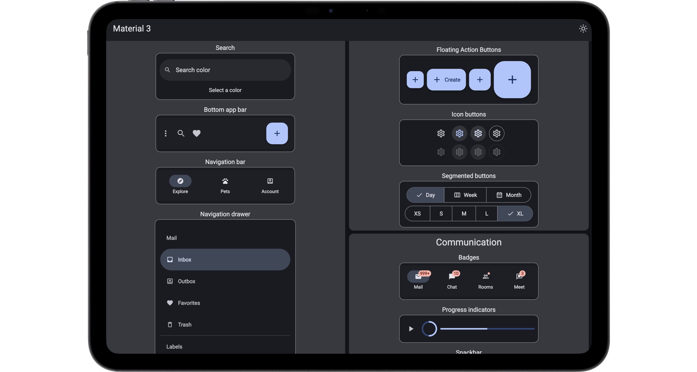

import { CardGrid, LinkButton, LinkCard, Steps, Tabs, TabItem } from '@astrojs/starlight/components';



Slint Material Components bring the Material 3 design system to Slint applications.

## Start a new project

Choose a template to create a ready-to-run project in your preferred language.

<CardGrid>
<LinkCard title="Rust template" description="Create a Material application with Rust." href="https://github.com/slint-ui/material-rust-template" />
<LinkCard title="C++ template" description="Create a Material application with C++." href="https://github.com/slint-ui/material-cpp-template" />
<LinkCard title="Node.js template" description="Create a Material application with Node.js." href="https://github.com/slint-ui/material-nodejs-template" />
<LinkCard title="Python template" description="Create a Material application with Python." href="https://github.com/slint-ui/material-python-template" />
</CardGrid>

## Add Material to an existing project

<div class="release-picker">
    <div class="release-picker__latest">
        <h3>Material Components 1.1.0</h3>
        <p>Requires Slint 1.18 or newer.</p>
        <div class="release-picker__actions">
            <span class="not-content">
                <LinkButton href={`${import.meta.env.BASE_URL}zip/material-1.1.0.zip`}>Download ZIP</LinkButton>
            </span>
            <a href={`${import.meta.env.BASE_URL}changelog/`}>View Release Notes</a>
        </div>
    </div>
</div>

<Steps>
1. Download and extract the current release into your project.
2. Add the release to the `library-paths` of your project file, as shown below.
3. Import Material components in your `.slint` files.
</Steps>

### Configure the Component Library

In your application's [project file](https://snapshots.slint.dev/master/docs/slint/guide/tooling/project-file/#libraries),
map `material` to the `slint-project.json` of the release:

```json
{
    "edition": "1.20",
    "main": "ui/main.slint",
    "library-paths": {
        "material": "material-1.1.0/slint-project.json"
    }
}
```

The Material components then keep their own edition, whatever edition your application uses.

Pass the project file's directory to your build or loading API:

<Tabs syncKey="dev-language">
<TabItem label="Rust">
```rust
// build.rs
fn main() {
    slint_build::compile(".").unwrap();
}
```
</TabItem>
<TabItem label="C++">
```cmake
slint_target_sources(my_application .)
```
</TabItem>
<TabItem label="NodeJS">
```javascript
let ui = slint.loadFile(".");
```
</TabItem>
<TabItem label="Python">
```python
ui = slint.load_file(".")
```
</TabItem>
</Tabs>

Then import the components from `@material`:

```slint no-test
import { FilledButton } from "@material";
```

## Next Steps

All the documentation for Slint's Material UI components can be found on this site.

Follow the development in the [https://github.com/slint-ui/slint/tree/master/ui-libraries/material](https://github.com/slint-ui/slint/tree/master/ui-libraries/material).

To learn more about Material Design, dive into Google's comprehensive [Material Design 3 documentation](https://m3.material.io/components).

Compose designs in Figma by taking advantage of the [Material Design 3 Figma Kit](https://www.figma.com/community/file/1035203688168086460/material-3-design-kit)
